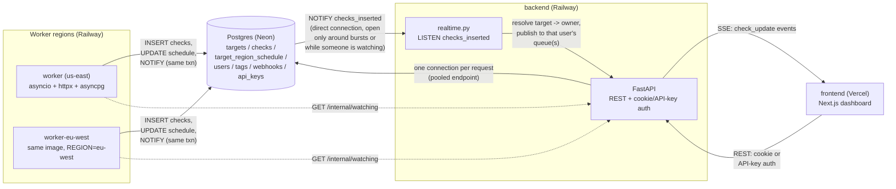
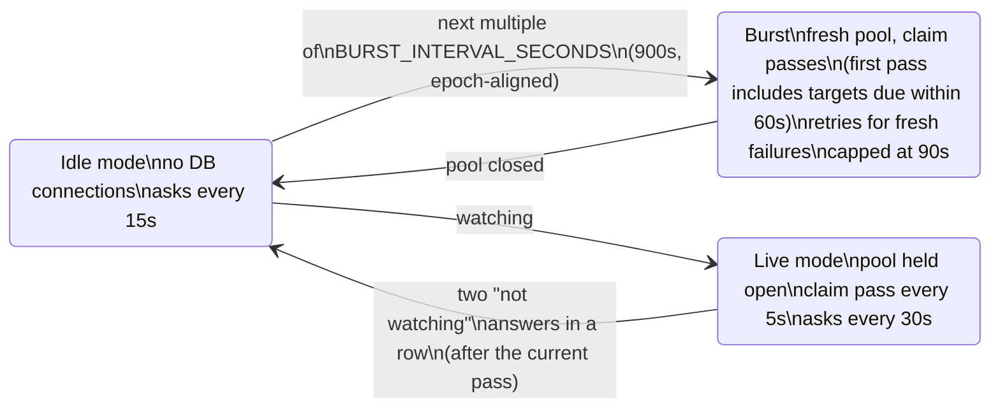
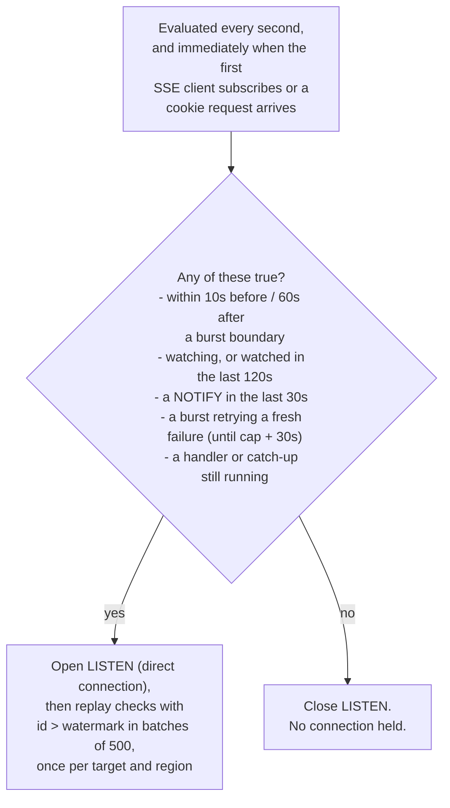
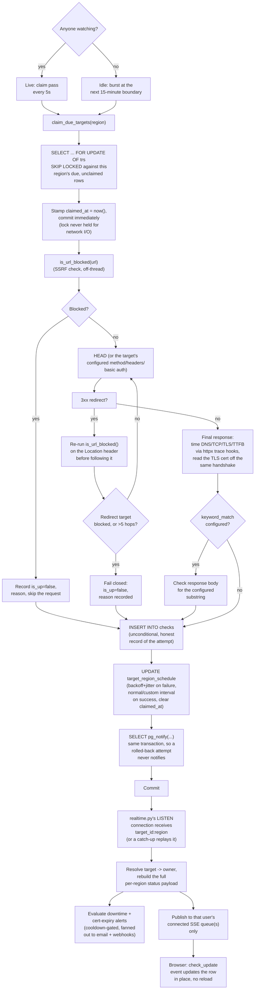

# Architecture

A map of how this system fits together: what runs where, how a check actually flows through
it end to end, and where each piece of code lives.

## System overview

Two independent worker regions check every target, writing to one shared Postgres database.
How often they check depends on whether anyone is using the site: while someone is signed in,
each target is checked on its normal interval and results reach the dashboard within moments;
the rest of the time, both regions run a clock-aligned batch every 15 minutes and the database
sleeps in between. The backend opens a connection per request for ordinary traffic, and opens a
`LISTEN` connection only while results can arrive, so it can push each one to a connected
browser over Server-Sent Events. The frontend never talks to Postgres or the worker directly.
Every request goes through the backend's HTTP/SSE API.

Each worker region only ever reads and writes its own region's rows in
`target_region_schedule`, so the two never contend with each other, and neither talks to the
other directly. They're connected only through the database and, from there, through what the
backend chooses to push out. See [`docs/adr/003-multi-region-coordination.md`](docs/adr/003-multi-region-coordination.md)
for the full reasoning behind that split.

Two kinds of database connection matter here. Ordinary app traffic goes through Neon's
**pooled** endpoint, one short connection per request that's closed as soon as the request ends.
The backend's `LISTEN` session uses Neon's **direct** (non-pooled) endpoint instead. A pooled
connection's underlying physical backend can be swapped between queries, so a `NOTIFY` sent
while a different backend happens to be attached would never be delivered. See
`backend/config.py`'s `LISTEN_DATABASE_URL` and `backend/README.md` for the details. Every
connection is tagged with an `application_name` (`api`, `api-listen`, `worker-<region>`), so
`pg_stat_activity` shows exactly which service holds what at any moment.

## Scheduling: live mode and idle mode

The database is serverless Postgres on a free tier, where compute accrues for as long as the
database is awake and stops once it has been idle for five minutes. The scheduler is built
around that: the database is awake while someone is using the site or a batch is running, and
asleep otherwise. [`docs/adr/004-viewer-aware-scheduling.md`](docs/adr/004-viewer-aware-scheduling.md)
covers the reasoning and the alternatives.

**Who's watching.** The backend counts the site as watched while any SSE stream is open, or
for 5 minutes after any cookie-authenticated request. API-key requests never count. It answers
from memory at `GET /internal/watching`, authenticated with a shared secret, and each worker asks
on a timer. A worker that gets no clear answer treats it as "not watching." A dashboard tab
hidden for 3 minutes closes its stream, and resyncs when it's shown again.

- **Live mode.** A claim pass runs every 5 seconds on a held pool. Each target is checked on
  its normal interval (5 minutes by default, or its own interval with a 30 second floor), and a
  failing target backs off on the usual curve.
- **Idle mode.** No pool and no connections. Both regions wake on the same epoch-aligned
  boundaries, every 15 minutes by default, regardless of when each one started. A burst opens a
  fresh pool, runs a first claim pass that includes anything due within the next 60 seconds,
  keeps running passes only while a target on its first or second consecutive failure has a
  retry due before the 90 second cap, then closes the pool. Retention pruning runs in the first
  pass after each UTC midnight.

**The `LISTEN` lifecycle.** The backend holds its `LISTEN` connection only while a notification
can arrive, and replays anything it missed whenever it opens.

The watermark is the highest check id the backend has handled, advanced by both live
notifications and replays. At startup it's set to the newest check older than 10 minutes and a
catch-up runs immediately, so a restart in the middle of a burst still delivers that burst's
alerts. A dropped connection reconnects within a second and catches up the same way. Replays
are safe: alert history suppresses duplicate alerts, and a repeated push carries the same
current state.

A typical idle burst, from the database's point of view:

| Time relative to the boundary | What happens |
|---|---|
| -10s | Backend opens `LISTEN` and runs a catch-up query |
| 0s | Both regions open a pool, claim due targets, check them, write results, close the pool |
| about +1s | Last check committed; each one has already been pushed and alert-evaluated |
| +60s | Backend closes `LISTEN` (later if a fresh failure is being retried) |
| +5 to 6 min | Neon suspends the database after five idle minutes |

## Deployment targets

| Piece | Where | Notes |
|---|---|---|
| Frontend | Vercel | Next.js, builds from `frontend/` on every push to `main` |
| Backend API | Railway | One service, `backend/Dockerfile`, binds to Railway's injected `PORT` |
| Worker (region 1) | Railway | `worker/Dockerfile`, `REGION=us-east` |
| Worker (region 2) | Railway | The same image as region 1, with only `REGION=eu-west` set differently |
| Database | Neon | Serverless Postgres that suspends after five idle minutes; pooled endpoint for app traffic, direct endpoint for the backend's `LISTEN` session and for Alembic migrations |
| Outgoing email | Resend | Downtime/recovery/cert-expiry alerts, password reset |

Every service reads its config from environment variables only. Nothing is hardcoded per
environment. `ENVIRONMENT=production` on the backend forces `COOKIE_SECURE=True` and
`COOKIE_SAMESITE="none"` regardless of what those two variables are explicitly set to, since the
frontend and backend live on different origins in production and a misconfigured cookie would
silently break login rather than fail loudly.

## Request flow: a check happens

This is the core loop end to end. It starts with a worker deciding a target is due and finishes
with a browser's dashboard updating with no reload. The claim pass is the same in both modes;
only what triggers it differs.

A few details that don't fit cleanly in the diagram:

- **Row-claiming never blocks.** `SKIP LOCKED` means a second worker instance in the same
  region hitting the same due row at the same moment simply doesn't see it and moves on to
  whatever else is due. There's no polling, no deadlock, and no retry loop involved.
- **A crashed worker self-heals.** A claim older than 120 seconds is treated as abandoned and
  becomes claimable again, without any heartbeat or lease-renewal mechanism.
- **The redirect-SSRF check runs on every hop, not just the first request.** A target can pass
  validation at creation time and still redirect to a blocked address later, whether through DNS
  rebinding or a URL that starts safe and gets reconfigured upstream, so each `Location` header
  is independently re-checked before it's followed. If a target has custom headers or basic-auth
  credentials configured, those are dropped the moment a redirect crosses to a different host,
  so a secret never gets forwarded to a host the user never configured it for.
- **The check result is written before scheduling is decided.** `is_up=false` lands in `checks`
  unconditionally; backoff only changes when the *next* attempt happens, never whether this one
  was honestly recorded.
- **Alert evaluation can never block the push.** It runs inside its own `try/except` in the same
  handler that publishes the SSE event, so a Resend outage or an unreachable webhook can only
  ever cost that one alert. The real-time update itself is never affected.

## Component map

### `backend/`

| Module | What lives there |
|---|---|
| `routers/auth.py` | Register/login/logout/me, password change, alert preferences, account deletion (cascades to everything owned by the user), forgot/reset password |
| `routers/targets.py` | Target CRUD, request customization (method/headers/basic auth/keyword match), pause/resume, tag attach/detach, per-region status, check history (paginated for API-key callers), windowed analytics, CSV export, the SSE stream endpoint |
| `routers/tags.py` | Tag CRUD (create/rename/delete) |
| `routers/webhooks.py` | Webhook CRUD, including the alert-type/enabled toggles |
| `routers/api_keys.py` | API key issuance and revocation, cookie-auth only and deliberately never key-eligible itself |
| `realtime.py` | The `LISTEN` lifecycle controller and missed-notification catch-up, per-user SSE pub/sub, the shared "is anyone watching" check, and downtime/cert-expiry alert evaluation |
| `activity.py` | The in-memory timestamp of the last cookie-authenticated request |
| `routers/internal.py` | `GET /internal/watching`, the secret-authenticated endpoint the workers ask before choosing a mode |
| `database.py` | The async engine: one connection per request (`NullPool`), tagged `api` |
| `logging_setup.py` | INFO to stdout, warnings and errors to stderr, and the workers' watching polls kept out of the access log |
| `webhooks.py` | Signs and sends a webhook delivery (HMAC-SHA256, one attempt, SSRF-checked immediately before send) |
| `mail/` | A thin Resend wrapper plus plain-text email templates (alerts, password reset) |
| `security/ssrf.py`, `security/crypto.py` | The SSRF blocklist and the Fernet wrapper encrypting a target's basic-auth password at rest |
| `auth/` | Cookie session creation/verification (JWT), the API-key dependency factory, password hashing |
| `analytics.py` | Windowed uptime %, latency percentiles, and MTTR, shared with the CSV export's SLA/incident computation |
| `export.py` | Builds the compliance CSV (summary + incidents + raw check rows) |
| `models/` | SQLAlchemy models, one file per table |
| `alembic/` | Schema migrations, applied automatically on boot |

### `worker/`

| Module | What lives there |
|---|---|
| `scheduler.py` | The live/idle mode controller: the 5 second live loop, epoch-aligned idle bursts, in-burst retries, pool lifecycle, and when retention runs |
| `watching.py` | Asks the backend whether anyone is watching; any failure counts as "no" |
| `main.py` | A claim pass: claim due targets for this region, check them concurrently (bounded by a semaphore), write results, reschedule, notify. Also builds the pool and starts the scheduler |
| `checker.py` | The actual HTTP check: method selection, manual redirect-following with per-hop SSRF revalidation, DNS/TCP/TLS/TTFB timing capture, TLS cert capture, keyword matching |
| `backoff.py` | The exponential-backoff-with-jitter curve used after a failed check |
| `retention.py` | Prunes check rows older than the retention window, once per UTC day, inside a claim pass |
| `ssrf.py`, `crypto.py` | The worker's own copies of the SSRF blocklist and the Fernet credential decryptor, deliberately duplicated from the backend's rather than shared, since the two services are deployed independently |
| `config.py` | Environment-driven settings: region identity, check interval, timeout, retention window, backend URL, internal secret, burst interval |
| `logging_setup.py` | INFO to stdout, warnings and errors to stderr, httpx request logging kept at warning level |

### `frontend/`

| Directory | What lives there |
|---|---|
| `app/` | Route pages: landing, auth, dashboard (list + per-target detail), settings |
| `components/` | The dashboard's own vocabulary: `signal-light.tsx`/`latency-gauge.tsx` (the two custom instrument components), `timing-waterfall.tsx`, `uptime-heatmap.tsx`, `incident-timeline.tsx`, `latency-chart.tsx`, plus the settings/webhook/API-key/tag management UI |
| `components/ui/` | Small shared primitives (button, input, dialog, switch, card) |
| `lib/api.ts` | The one place every request to the backend goes through |
| `lib/use-hidden-tab-cutoff.ts` | Closes the dashboard's live stream after a tab has been hidden for 3 minutes |
| `lib/thresholds.ts`, `lib/status.ts` | The shared logic that classifies a check as up/degraded/down, kept in one place so the dashboard list and the detail page can't silently disagree |

All data fetching goes through `lib/api.ts`; no component calls `fetch` directly. Live updates
arrive over one `EventSource` connection per visible dashboard tab, merged into the existing
in-memory list by target id, keeping whichever reading is newest per region. A tab hidden for 3
minutes closes its stream; when it's shown again it reopens the stream, refetches, and merges.
There is no client-side polling anywhere in this app.
